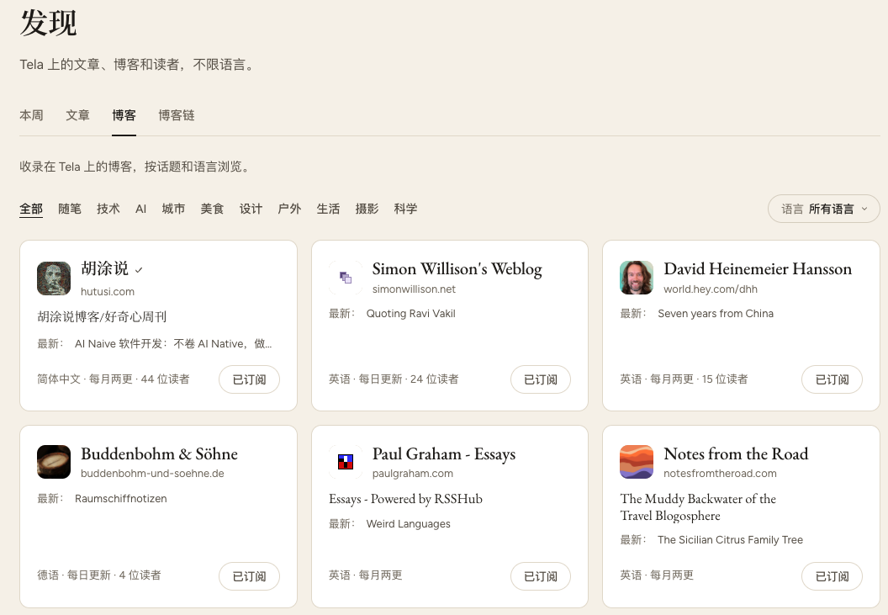
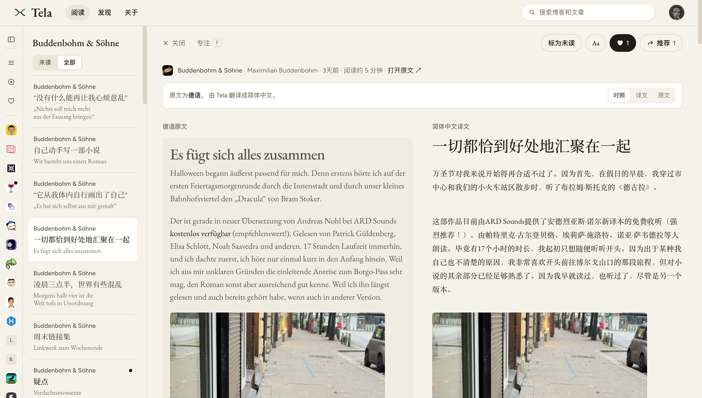
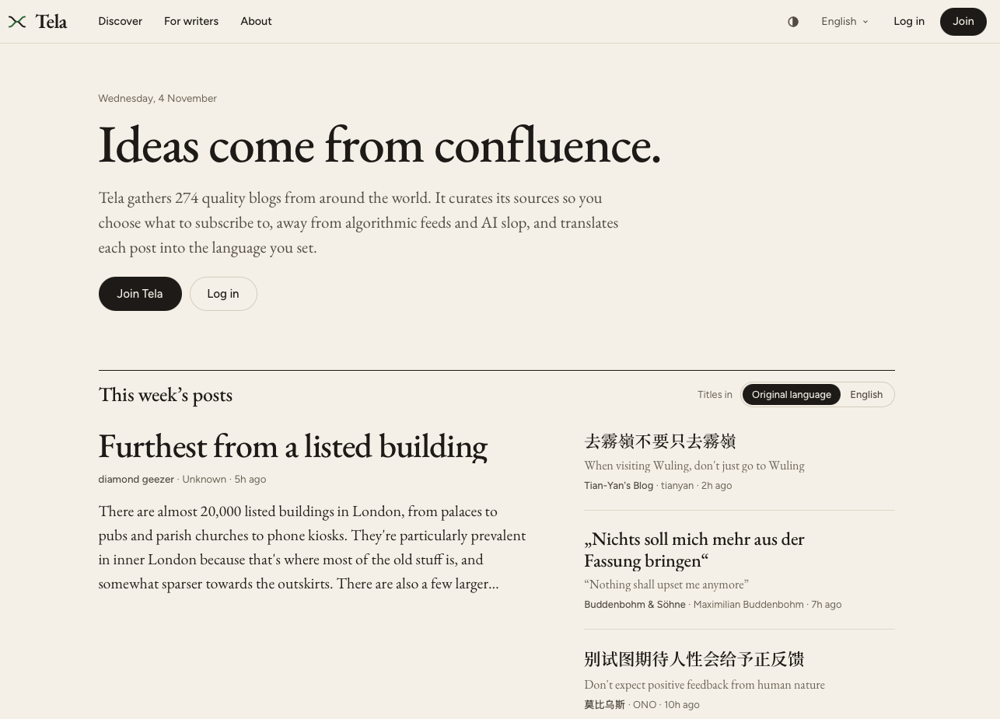

经过三个多月的打磨，[TelaRead](https://telaread.com)第一个公开版本终于可以正式上线了。这里简单介绍下 TelaRead 的基本功能特性。

## 博客发现与订阅

订阅博客最便捷的方式是在[「发现」](https://telaread.com/discover/blogs)页面，在这里你可以浏览或搜索到 TelaRead 收录的各类不同语言的博客，目前发现页支持按照话题或语言过滤筛选，点击「订阅」按钮便可一键订阅该博客。也可以点击博客卡片进入查看该博客的详情和文章列表。

如果在「发现」没有找到想要订阅的博客，或者你有需要订阅博客的网址或 RSS 地址，可以在「添加博客」页面直接输入地址添加订阅。「添加博客」按钮在 Dashboard 左侧博客列表栏的最下面，或者点击右上角个人头像的下拉菜单中找到。TelaRead 通过 RSS 和 Atom 获取博客更新，在「添加博客」的输入框中即使只输入网站地址而非 RSS 地址，点击「查找订阅源」按钮后 TelaRead 也会搜寻到该网站提供的 RSS 或 Atom 订阅源。

如果你使用 inoreader 或其他 RSS 阅读工具，也可以将现有订阅列表导出成 OPML 文件，然后将其导入到 TelaRead 中。在「设置 → 订阅」中导入该 OPML 文件。如果清单比较大，导入可能会需要一定时间，请耐心等待。有些订阅源可能因为博客无法访问等原因无法读取，你可以在导入后确认一下。

默认情况下，订阅博客仅对自己可见，如果希望公开自己订阅的博客，可在「设置 → 隐私」中设置。

## 阅读列表与文件夹

「阅读」侧栏按全部文章、当天更新和喜欢的文章组织内容，也可以只查看某个博客或文件夹的更新。列表中的「未读」筛选适合日常阅读，切换到「全部」即可查看已读文章。默认情况下，打开文章就会将其标为已读。单篇文章可以恢复为未读，当前列表也可以全部标为已读。如果不小心标记全部已读，可点击提示中的撤销。

文件夹在「设置 → 订阅」中管理。支持拖动博客，也可以用「选择」批量移动；如果是通过手机端浏览器访问可以通过每行的文件夹按钮移动。文件夹分组仅自己可见，如果想要把博客列表分享给其他人可以使用「博客链」功能。删除文件夹会保留其中的订阅，导出 OPML 则会保留分组。

如果想要收藏或标记博文以后再阅读，可以将文章标记为「喜欢」，之后从侧栏的「喜欢」里可找到收藏博文并直接打开。默认情况下，「喜欢」文章仅对自己可见，如果希望公开「喜欢」的文章，可在「设置 → 隐私」中设置。

## 双语阅读

TelaRead 支持将外语文章翻译成读者设置的阅读语言，目前支持简体中文、繁体中文、英语和法语四种阅读语言。你可以选择只显示原文、译文，或同时显示原文和译文进行双语阅读，双语阅读适合电脑宽屏，以左右栏方式呈现。

文章按需翻译，会在第一次被打开的时候进行翻译，翻译需要一定的时间，如果该文章被其他同类型阅读语言的用户打开并翻译过，那后续用户打开时就会直接看到译文，而无需等待。

「设置 → 语言」允许分别指定界面语言和翻译语言。例如，菜单使用英文，阅读语言设置为简体中文，那么英语文章则会被译成中文。如果希望不对某类型语言翻译，比如阅读语言设置成简体中文，但我也能看懂繁体中文，则只需将繁体中文加入「从不翻译」，则遇到繁体中文文章，也无需显示简体中文译文。希望先读原文的读者可以关闭「自动翻译」，需要时再点击点击文章页面的「翻译」。

译文由大模型翻译生成，可能存在错误。如果你发现有翻译错误，可选中有误的段落，点击「译文有误」可提交具体反馈。

## 阅读偏好与笔记

字号、正文行宽和明暗主题可在阅读页面上设置，也可在「设置 → 阅读」中调整。阅读器会在本机保存已加载的文章，并在空闲时预取未读正文，离线时仍可继续阅读本机已缓存的内容。

在电脑上可以按 `j`、`k` 可切换到下一篇或上一篇文章，`[` 用于收起侧栏，`f` 进入全屏专注模式，`Esc` 关闭当前文章。选中一段原文或译文后，可以划线或写笔记，目前划线和笔记仅本人可见。

## 文章推荐、关注与博客链

「推荐」用于公开分享一篇文章。推荐者可以附上自己的评语，文章与推荐语会出现在其个人主页，博主也可以在仪表盘中阅读这些评语。读者可以通过「发现」页中的推荐进入推荐者的主页并关注对方。关注第一位读者后，「关注」入口会出现在导航中，这样便建立了与其他读者或作者的连接网络。

想要分享一组博客时，你可以创建一份「博客链」。在订阅管理页打开文件夹选项，选择「创建博客链」，即可从现有分组建立清单，可以为每个博客附上一句话。博客链可以设置为私有，或设为公开后分享链接。

公开博客链也提供 RSS 和 OPML。前者将这组博客的文章合为一个订阅源，后者列出各个博客的订阅地址，供其他阅读器导入。

## 博客认领

如果你在「发现」页找到了自己的博客，欢迎前往页面认领。或者也可以在[写作者页面](https://telaread.com/writers)选择「认领你的博客」，输入博客地址后，按页面提示任选一种方式验证所有权：

- 将给出的 meta 标签加入博客首页的 `<head>`，发布后点击「验证」。验证完成后可移除标签。
- 在博客上添加页面给出的 `rel="me"` 链接，指向自己的 TelaRead 个人主页，然后验证。
- 如果 GitHub 个人主页与博客已互相链接，在账户设置中关联该 GitHub 账户后即可验证。

认领后，作者便可以在「仪表盘」管理自己的博客，并查看到读者的反馈数据。

## 数据导出与账户管理

TelaRead 不绑定用户，你可以在任何时候将订阅数据迁移到其他阅读器，需要迁移时，可在「设置 → 订阅」导出 OPML。若需备份划线、推荐、喜欢的文章及个人资料，可到「设置 → 隐私 → 你的数据」下载 JSON 文件。

在「设置 → 个人资料」可以编辑用户名称、头像和简介，「账户」页可更改密码、管理登录方式或退出所有设备。第三方应用的授权单独列在「已连接的应用」，其中注明各应用的读写权限，可随时断开连接。如果你是软件开发者，欢迎为 TelaRead 开发第三方应用，TelaRead 的开放 API 文档在 [github.com/hutusi/telaread](https://github.com/hutusi/telaread) 仓库里，开发调试应用时，可以在「设置 → 开发者」里登记应用。

首次使用请从 [TelaRead 首页](https://telaread.com)注册。目前 TelaRead 仍采取邀请注册制，感谢你花时间阅读本文，如果你还没有注册，欢迎使用邀请码 **TELAREAD** 注册体验，也欢迎你邀请喜欢深度阅读的朋友一起体验。

